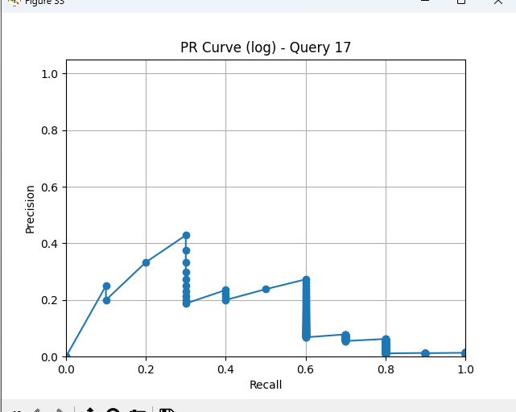
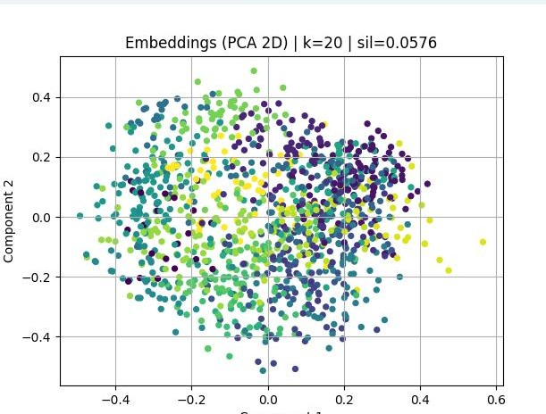
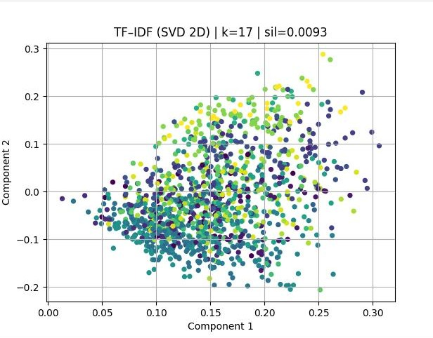
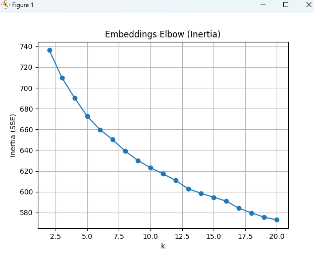
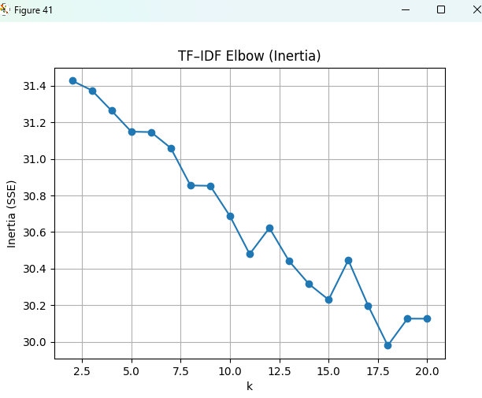

# Information Retrieval & Document Clustering

**University project · 7th semester · Winter 2025**  
**Author:** Themistoklis Rafail Voutsis  
**Technologies:** Python, NLTK, scikit-learn, TF-IDF, K-Means, Sentence Transformers

A document search and analysis pipeline built for a university Information Retrieval course. It implements an **inverted index and Vector Space Model (VSM)**, compares term-weighting and document-ranking strategies, evaluates retrieval effectiveness, and explores **document clustering** using sparse TF-IDF features and dense sentence embeddings.

> **Reproducibility note:** The submitted archive contained the Python program and a report, but **not the original document collection or relevance judgments**. The source code is included here; full experimental reproduction requires the course-provided corpus (see [Dataset setup](collection/README.md)). The plots below were extracted from the original report, not regenerated in this repository.

## At a glance

| Component | Approach |
|---|---|
| Corpus indexing | Inverted index storing `term → {document_id: term_frequency}` |
| Preprocessing | Lowercasing, regex tokenization, stopword removal, Porter stemming |
| Ranked retrieval | VSM with logarithmic and augmented TF-IDF and cosine similarity |
| Evaluation | Precision, Recall, F1, Precision@5, Precision@10 and precision–recall curves |
| Parameter exploration | scikit-learn `TfidfVectorizer` across **48 combinations configured in the source** |
| Document clustering | K-Means with TF-IDF and `all-MiniLM-L6-v2` sentence embeddings |
| Cluster assessment | Silhouette score, inertia/elbow plots, SVD and PCA visualization |

## System workflow

```text
Documents + queries + relevance judgments
                │
                ▼
       Text preprocessing
                │
       ┌────────┴─────────┐
       ▼                  ▼
   Inverted index     TF-IDF vectors
       │                  │
       ▼                  ▼
 Custom VSM ranking   sklearn ranking
       │                  │
       └────────┬─────────┘
                ▼
 Retrieval evaluation (P/R/F1/P@k)
                │
                ▼
     K-Means document clustering
   ┌────────────┴───────────────┐
   ▼                            ▼
Sparse TF-IDF               Dense embeddings
   ▼                            ▼
SVD visualization           PCA visualization
```

## Implementation

### 1. Text preprocessing and inverted indexing

The program builds an inverted index from text files in `collection/docs/`. It normalizes text, filters a predefined stopword list, and applies Porter stemming through NLTK. The index stores document-level term frequencies. Auxiliary document length and maximum-term-frequency values support alternative weighting schemes.

The relevance judgments are filtered against available document IDs before evaluation to avoid crediting missing documents.

### 2. Vector Space Model and ranking

The custom VSM implementation supports two term-weighting options:

- **Log TF-IDF:** `(1 + log10(tf)) × log10(N / df)`
- **Augmented TF-IDF:** `(0.5 + 0.5 × tf / max_tf) × log10(N / df)`

Each query is processed using the same tokenization and stemming procedure as the documents. Results are ranked with cosine similarity. Document norms are precomputed for efficiency.

### 3. Retrieval experiments

The project compares the custom VSM with scikit-learn TF-IDF retrieval. The source code searches combinations of n-gram range, IDF usage, vector normalization, minimum document frequency and maximum document frequency, selecting the leading configuration by mean **P@10**. Indexing and retrieval times are measured separately.

**Important:** The original written report mentions 32 TF-IDF configurations, but the supplied Python source defines **48** combinations (2 n-gram options × 2 IDF options × 1 sublinear-TF option × 3 normalization options × 2 `min_df` options × 2 `max_df` options). This README documents the code as supplied rather than silently reconciling the discrepancy.

### 4. Document clustering

The same document collection is clustered with K-Means using two representations:

- **Sparse TF-IDF:** best-scoring TF-IDF configuration followed by K-Means; 2D visualization through TruncatedSVD.
- **Dense sentence embeddings:** `sentence-transformers/all-MiniLM-L6-v2`, L2 normalization and K-Means; 2D visualization through PCA.

Cluster counts from 2 through 20 are compared using silhouette scores, with elbow plots as supporting diagnostics.

## Selected figures from the submitted report

These figures are **historical outputs shown in the course report**. They have not been independently reproduced from the missing dataset.

### Retrieval performance



### TF-IDF and embedding-based clustering

| Dense embeddings (PCA) | Sparse TF-IDF (SVD) |
|---|---|
|  |  |

For these reported examples, the embedded plot labels indicate **k = 20, silhouette = 0.0576** for dense embeddings and **k = 17, silhouette = 0.0093** for sparse TF-IDF. Both scores are low, suggesting limited separation; a 2D projection should not be treated as proof of strong clusters.

<details>
<summary>Elbow charts</summary>





</details>

## Repository layout

```text
information-retrieval-search-engine/
├── README.md
├── main.py
├── requirements.txt
├── .gitignore
├── collection/
│   ├── README.md
│   └── docs/.gitkeep
└── docs/
    └── images/
        ├── vsm_precision_recall.png
        ├── embeddings_elbow.png
        ├── tfidf_elbow.png
        ├── embedding_clusters.jpg
        └── tfidf_clusters.jpg
```

## Setup and execution

Use Python **3.11 or 3.12** as a practical environment to try, although the submission has not been tested on a fresh installation here. From the repository root:

```bash
python -m venv .venv
```

Activate the environment (Windows PowerShell):

```powershell
.venv\Scripts\Activate.ps1
```

Install dependencies and launch:

```bash
python -m pip install -r requirements.txt
python main.py
```

Before running, copy the course corpus to `collection/docs/`, place `Queries.txt` and `Relevant.txt` in `collection/`, and read [Dataset setup](collection/README.md). The first use of Sentence Transformers may download model files. **Execution opens multiple Matplotlib windows and may take time** on larger collections due to parameter exploration and clustering.

## Limitations and attribution

- The original evaluation dataset is not included in this repository. Results should be treated as *reported academic experiments*, not a verified benchmark or production deployment.
- Evaluation depends on the supplied relevance judgments and their correspondence with the query list.
- The original PDF report contained personal academic identifiers and draft text, so it was not included in the public-ready archive; selected figures and a new technical overview are provided instead.
- External libraries and the sentence-transformer model remain the property of their respective authors/licensors. No license is asserted over any course-provided dataset.
- This repository documents an **academic prototype**, not a hosted search service or deployable search product.
